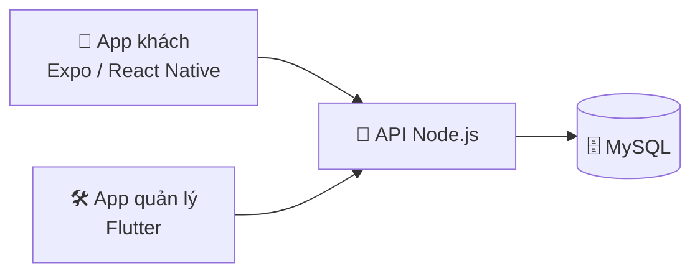

<div align="center">

# 🛍️ Đặc Sản Việt

**Một repo duy nhất cho cả hệ thống bán đặc sản Việt — API, app khách và app quản lý.**


</div>

---

## ✨ Giới thiệu

Một repo duy nhất cho cả hệ thống Đặc Sản Việt, gộp từ 3 repo cũ:

| Thư mục | Repo cũ | Mô tả |
| --- | --- | --- |
| `apps/api` | `nodejs-api-dacsanviet` (JavaScript) | Backend API Node.js: routes, controllers, models, socket |
| `apps/app` | `dacsanviet-app-ui` (TypeScript) | App khách, React Native / Expo |
| `apps/manager` | `dacsanviet-manager` (Dart) | App quản lý cho admin, Flutter |

3 repo cũ được giữ nguyên, không sửa gì thêm. Lịch sử commit của 3 repo cũ được giữ lại qua `git subtree` (mỗi repo thành một thư mục trong `apps/`).

## 🧩 Kiến trúc hệ thống



Cả 3 app cùng trỏ về một backend API (mặc định cổng 3001).

## 📁 Cấu trúc repo

```
dac-san-viet-app/
├── apps/api/       # Backend API Node.js
├── apps/app/       # App khách, React Native / Expo
└── apps/manager/   # App quản lý cho admin, Flutter
```

## 🚀 Chạy local

Mỗi app chạy độc lập, chỉ cần cùng trỏ về một backend API.

### API

```bash
cd apps/api
npm install
cp .env.example .env   # điền DB (MySQL) và JWT
npm run dev            # nodemon server.js
```

### App khách (Expo)

```bash
cd apps/app
npm install
npm run setup          # copy .env.example -> .env rồi tự detect IP LAN
npm start              # expo start; app có sẵn script auto-ip cho máy thật
```

App trỏ tới API qua host cấu hình trong `.env` (máy local, iOS Simulator, Android Emulator, máy thật đều có mục riêng; mặc định code trỏ tới cổng 3001).

### App quản lý (Flutter)

```bash
cd apps/manager
flutter pub get
flutter run
```

## 📝 Lưu ý

- `apps/api/public/uploads/` chỉ chứa `.gitkeep`. Ảnh sản phẩm/avatar do người dùng upload là dữ liệu runtime, không commit vào repo — 71 file ảnh cũ (23MB) vẫn nằm ở repo API cũ, không mang qua đây.
- File `node_modules/` của API, file zip bugreport của app và thư mục `.idea/` đã được loại khỏi repo mới.
- File `apps/app/android/app/debug.keystore` là keystore debug mặc định của Android (dùng chung mọi máy dev), không phải key ký release.
